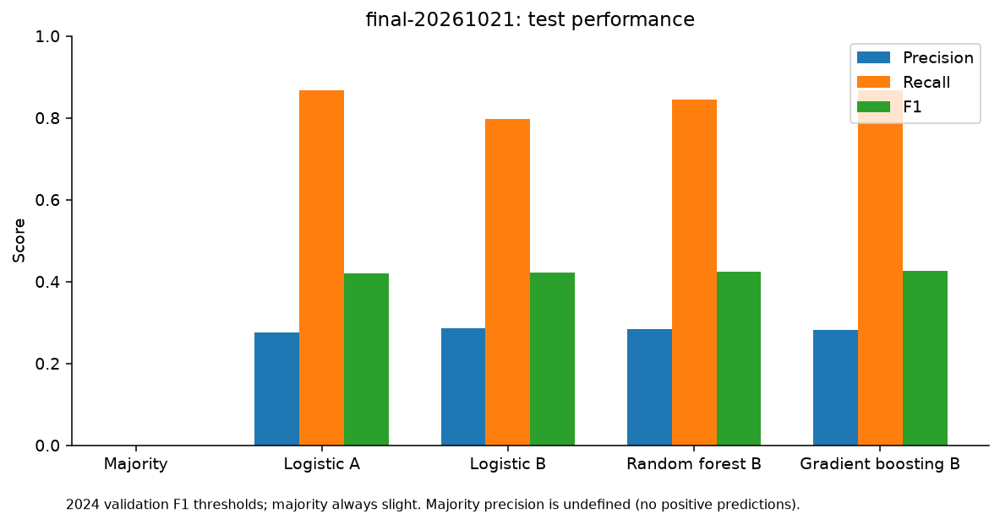
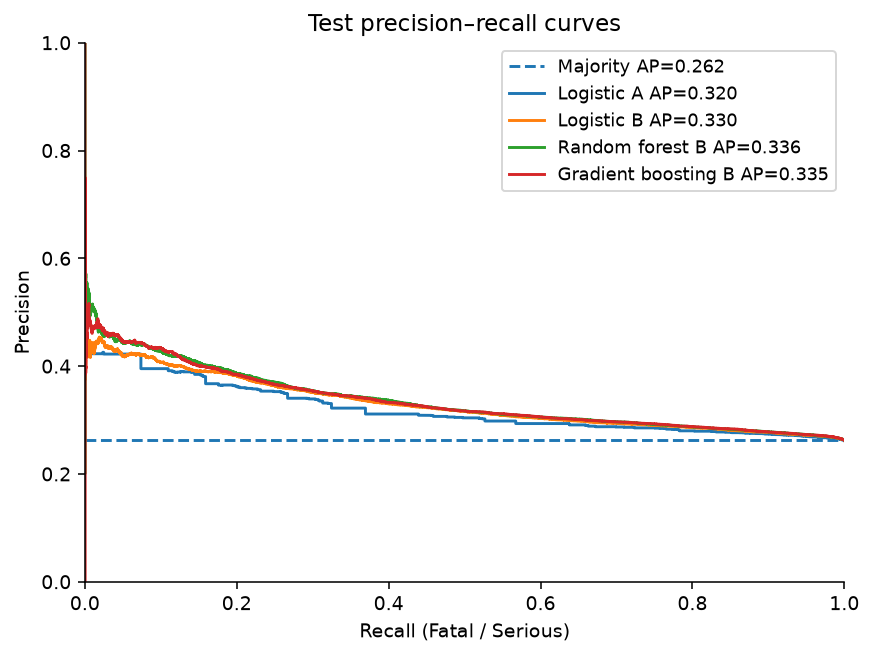

# STATS19 Collision Severity: A Temporal Machine Learning Study

## Overview

A reproducible research-training project for Dezhang Li's Computer Science portfolio. It classifies **recorded Fatal/Serious versus Slight collisions**, using 2024 for development and 2025 for a temporal test. This is retrospective severity classification among police-recorded injury collisions, not prediction of whether a collision will occur.

**Status:** computational study complete locally; no remote repository created or pushed. [English research report](report/RESEARCH_REPORT.md).

## Research Questions

1. How well do basic road attributes discriminate recorded collision severity?
2. Do environment and time variables add predictive information?
3. Do random forest and gradient boosting improve upon logistic regression in the following year?

## Dataset

Official [DfT STATS19 open data](https://www.gov.uk/government/statistical-data-sets/road-safety-open-data): 100,927 collisions in 2024 and 101,525 in 2025, plus the official dictionary. Recorded Fatal/Serious proportions are 24.8387% and 26.2438%. Only public collision tables are used, covering Great Britain, not all UK road incidents.

Source URLs, exact sizes and SHA-256 are in [data/manifest.json](data/manifest.json); [data instructions](data/README.md) explain acquisition and coding. Raw CSVs and the guide are excluded from Git.

Contains public sector information licensed under the [Open Government Licence v3.0](https://www.nationalarchives.gov.uk/doc/open-government-licence/version/3/). Source: Department for Transport, STATS19. Retain this attribution with derived results.

## Methods

- Target: official recorded collision_severity 1/2 → 1; 3 → 0. No adjusted severity estimates.
- **A:** speed_limit, road_type, junction_detail, first_road_class.
- **B:** A plus light_conditions, weather_conditions, road_surface_conditions, day_of_week and hour.
- Train/validation: stratified 2024 80/20 split, seed 20261021 (80,741 / 20,186). All 101,525 2025 records form the test set. Validation is not refitted into training after threshold selection.
- Train-only median imputation, speed standardization and one-hot encoding; explicit Missing/Unknown categories.
- Majority baseline; logistic A/B; random forest B; histogram gradient boosting B.
- Fixed model settings. Learned-model thresholds maximize **2024 validation F1**; no 2025 tuning. Main PR summary is **Average Precision**, distinct from separately saved trapezoidal PR-AUC.
- Outcome counts, adjusted severity, identifiers, coordinates and other non-allowlisted fields are excluded.
- Logistic coefficients and validation permutation importance describe model associations, not causes.

Exact settings: [protocol](docs/EXPERIMENT_PROTOCOL.md) and [frozen choices](results/final-20261021/frozen_choices.json).

## Key Results

2025 temporal test; positive class Fatal/Serious. NA precision means no positive predictions.

<!-- PERFORMANCE:START -->
| model | precision | recall | f1 | average_precision | roc_auc | brier |
|---|---|---|---|---|---|---|
| Majority | NA | 0.0000 | 0.0000 | 0.2624 | 0.5000 | 0.1938 |
| Logistic A | 0.2763 | 0.8676 | 0.4191 | 0.3195 | 0.5712 | 0.1911 |
| Logistic B | 0.2860 | 0.7970 | 0.4209 | 0.3299 | 0.5841 | 0.1901 |
| Random forest B | 0.2835 | 0.8450 | 0.4245 | 0.3363 | 0.5889 | 0.1897 |
| Gradient boosting B | 0.2818 | 0.8663 | 0.4253 | 0.3354 | 0.5887 | 0.1895 |
<!-- PERFORMANCE:END -->

Adding environment/time improves AP by **0.0104** and F1 by **0.0018**. Tree models improve some metrics slightly, without evidence of stable multi-year superiority or statistical significance. F1-optimized thresholds produce **70.80%–80.87% false-positive rates** among learned models; high recall is not deployment readiness.

[Exact counts and metrics](results/final-20261021/metrics.csv), [incremental comparisons](results/final-20261021/increments.csv), [probability bins](results/final-20261021/calibration.csv). The majority baseline has 73.76% accuracy but zero severe recall. Its constant-score trapezoidal PR-AUC is misleadingly high (0.6312); use AP (0.2624) for the main PR comparison.

## Figures




Also: [workflow](figures/final-20261021/workflow.png), [distributions](figures/final-20261021/distributions.png), [permutation importance](figures/final-20261021/feature_importance.png), [calibration](figures/final-20261021/calibration.png).

## Reproduction

Verified locally on **macOS 27.0.1 arm64, Python 3.13.2**, with pinned dependencies. Other platforms are not validated. Run all commands from this project directory. No external forensic tools, credentials or manual spreadsheet edits are needed.

Create an isolated environment:
```sh
python3.13 -m venv .venv
.venv/bin/python -m pip install -r requirements.txt
```

Rescore the included predictions without downloading raw data or training:
```sh
.venv/bin/python -m unittest discover -s tests -v
.venv/bin/python scripts/evaluate.py --run-id final-20261021
.venv/bin/python scripts/plot.py --run-id final-20261021
.venv/bin/python scripts/verify.py --run-id final-20261021 --compare repeat-20261021
.venv/bin/python scripts/tables.py
```
The verification script explicitly reports when absent raw files prevent checksum verification. Predictions contain only binary labels and model scores, not collision identifiers.

Rebuild from official source data and fit all models:
```sh
.venv/bin/python scripts/acquire.py
.venv/bin/python scripts/prepare.py
.venv/bin/python scripts/run.py --mode pilot --run-id my-pilot
.venv/bin/python scripts/evaluate.py --run-id my-pilot
.venv/bin/python scripts/plot.py --run-id my-pilot
.venv/bin/python scripts/run.py --mode final --run-id my-final
.venv/bin/python scripts/evaluate.py --run-id my-final
.venv/bin/python scripts/plot.py --run-id my-final
.venv/bin/python scripts/verify.py --run-id my-final --compare final-20261021
```
Use a fresh run ID: the trainer refuses to overwrite an existing directory. Acquisition requires internet and the exact official versions; changed size/hash stops reproduction for review. Existing verified raw files are reused. The original study ran the pilot before the formal experiment; it used only the 2024 training partition.

The recorded final and repeat runs have identical predictions, metrics and explanations. Initial parallel random-forest runs had negligible numerical differences that changed a few threshold-boundary decisions. They are retained under `results/original-*`; final code uses single-thread random-forest execution. No scientific model setting or scoring definition was changed. [Verification](results/final-20261021/verification.json) and [tests](results/final-20261021/tests.txt).

## Repository Structure

- `src/stats19/` — dictionary-based cleaning, feature allowlist, preprocessing, split and scoring.
- `scripts/` — acquisition, preparation, training, rescoring, plotting, verification and table rendering.
- `tests/` — 12 focused unit checks.
- `data/` — attribution and manifest; raw/intermediate/processed content is local only.
- `results/data/` — schema, dictionary extract, missingness and sample counts.
- `results/pilot-20261021/` — training-only pilot.
- `results/final-20261021/` — authoritative tables, predictions, parameters and logs.
- `results/repeat-20261021/` — deterministic full retraining evidence.
- `results/original-*/` — preserved pre-correction runs.
- `figures/` and `report/` — generated figures and English report.
- `docs/` — current protocol and labelled historical planning material, not a new approval system.

## Limitations

Weak class separation and high false-positive rates limit practical utility. There is only one year transition, no geographical holdout, uncertainty test or external validation. Serious and Fatal are combined. Recorded labels are affected by police reporting; no claim is made about underlying injury truth. Missing/Unknown frequencies change across years. Correlated predictors complicate permutation importance. Sparse calibration bins must be read with their counts. No causal, collision-incidence or production-deployment claim is supported.

## References

Primary references, full citations and links appear in the [report](report/RESEARCH_REPORT.md#references), including DfT guidance, Mannering & Bhat (2014), Umer et al. (2020), Breiman (2001), and scikit-learn metric/interpretation documentation.

## AI Assistance Disclosure

Codex/AI implemented the code, ran the analysis and drafted the report under user direction. These artifacts do not establish independent implementation or approval by Dezhang Li. Any application statement must accurately reflect the student's actual review, understanding and contribution. This is an unpublished research-training study.

No remote publication is performed. Original project code is supplied for review; an explicit code licence has not yet been chosen. Third-party packages are installed from requirements and not bundled; dataset-derived content retains the OGL attribution above. Historical internal approvals remain unsigned.
